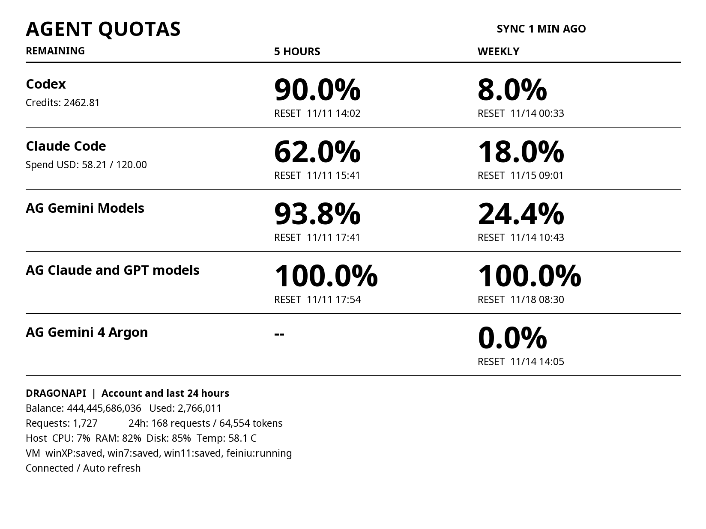

# Kindle Agent & DragonAPI Dashboard

把 Kindle 变成一块低功耗看板：展示 Agent 用量、DragonAPI 账户和服务器状态，自动刷新并保持横屏。



## 功能

- 展示 Codex、Claude Code 和 Antigravity 的剩余额度与重置时间。
- 查看 DragonAPI 账户、近 24 小时用量、主机资源和虚拟机状态。
- KUAL 菜单启动与停止；启动时横屏并阻止屏保，停止后恢复原设置。

Agent 用量来自设备上的 `agent-quotas.json`，**需要另行配置外部同步程序**；本仓库不包含该同步程序。没有同步文件时界面会提示等待同步。DragonAPI 数据直接从配置的 HTTPS 接口读取。

## 安装

需要已越狱的 Kindle、KUAL、Python 3、Pillow、FBInk 和 KOReader 的 Noto 字体。脚本默认使用 `/mnt/us/usbnet/bin/fbink` 及 `/mnt/us/koreader/fonts/noto/` 下的字体。

将仓库文件复制到 `/mnt/us/extensions/dragonapi-dashboard/`，将 `config.example.json` 复制为 `config.json`，填写 DragonAPI HTTPS 地址和控制台个人访问令牌。管理员数据需要对应权限，普通用户将 `scope` 设为 `user`。如设备默认 CA 证书不可用，把可信的 PEM 证书包保存为扩展目录下的 `ca-certificates.crt`。

刷新 KUAL 菜单，在 **DragonAPI Dashboard** 中启动或停止。退出时请选择 Stop，以恢复原来的屏幕方向和屏保设置。设备休眠和前光亮度由 Kindle 管理。

`/mnt/us` 不提供有效文件权限保护；请不要分享 `config.json` 或令牌。截图是实际设备画面，包含当时的使用数据。

## 开发

`bin/dashboard.py` 负责请求数据与绘图；`bin/dashboard.sh` 管理 KUAL 启停及屏幕状态。额度显示为 DragonAPI 原始 quota 单位。默认每 60 秒刷新，`refresh_seconds` 最小值为 30 秒。

```sh
sh -n bin/dashboard.sh
python3 -m py_compile bin/dashboard.py
python3 -c 'import json,xml.etree.ElementTree as E; json.load(open("menu.json")); json.load(open("config.example.json")); E.parse("config.xml")'
```

## PM2 状态

看板读取 Kindle 扩展目录中的 `pm2-status.json`，展示 Mac 的进程状态、CPU、内存和重启次数。采集脚本通过 SSH 原子写入状态文件，不传输 PM2 环境变量：

```sh
python3 scripts/collect_pm2.py --host mac --kindle root@kindle
```

`--pm2` 可指定 PM2 路径。文件的 `timestamp` 使用毫秒级 Unix 时间戳，进程字段包括 `name`、`status`、`cpuPercent`、`memoryBytes` 和 `restarts`。采集脚本也支持 `--host debian`，将结果写到单独的 `debian-pm2-status.json`；当前看板不显示 Debian 数据。超过 10 分钟未更新会标记 STALE；进程超出屏幕容量时自动轮换页面。
